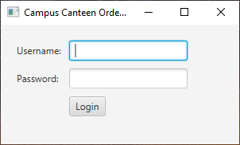
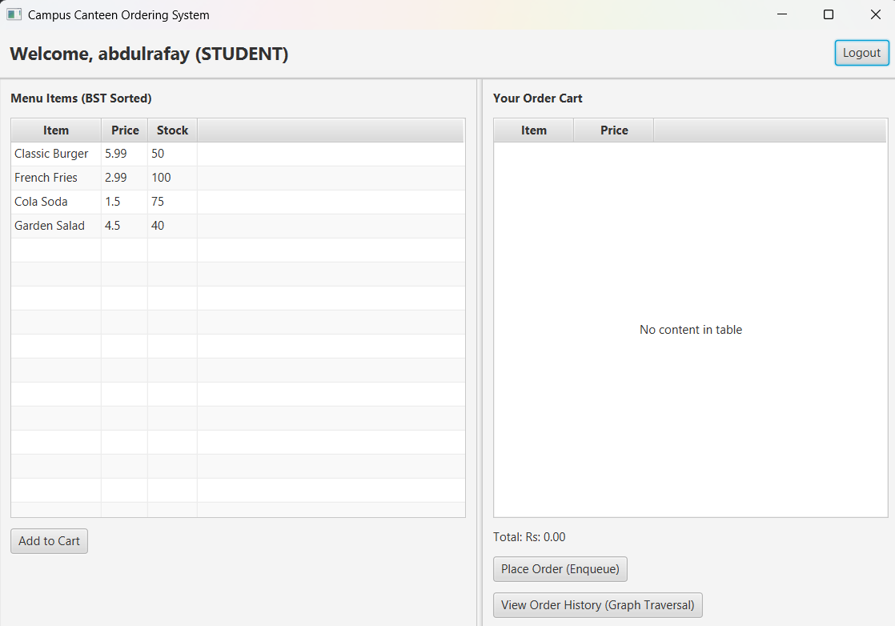
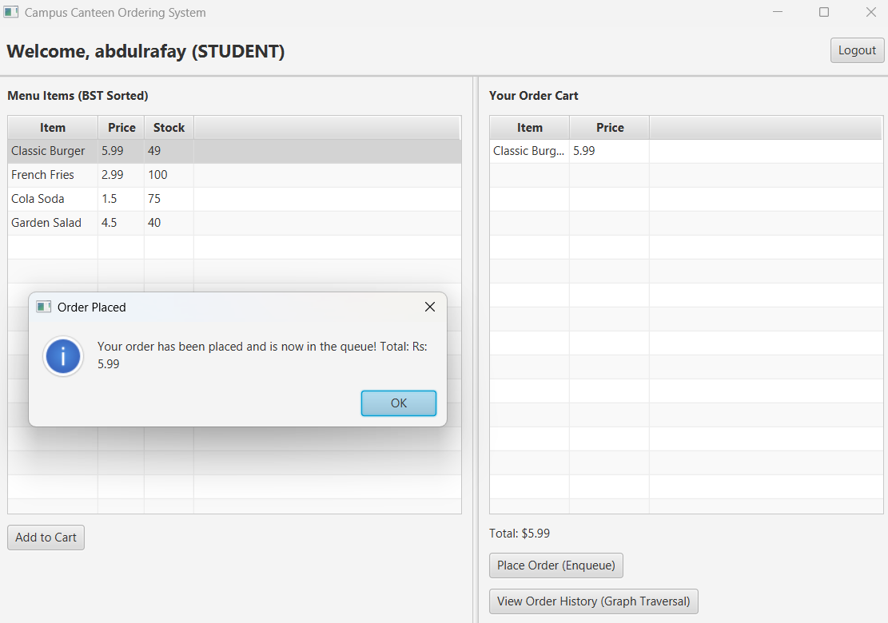
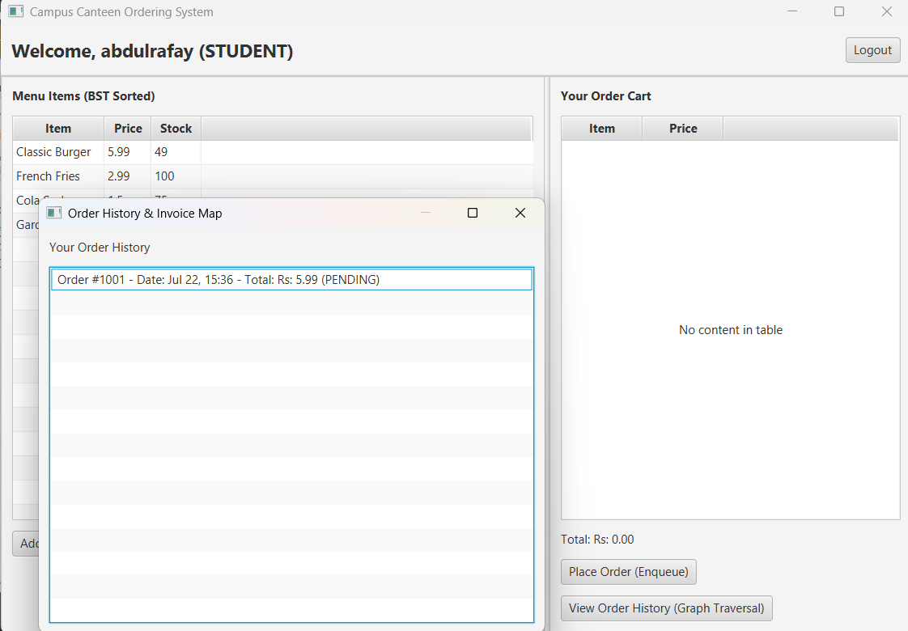
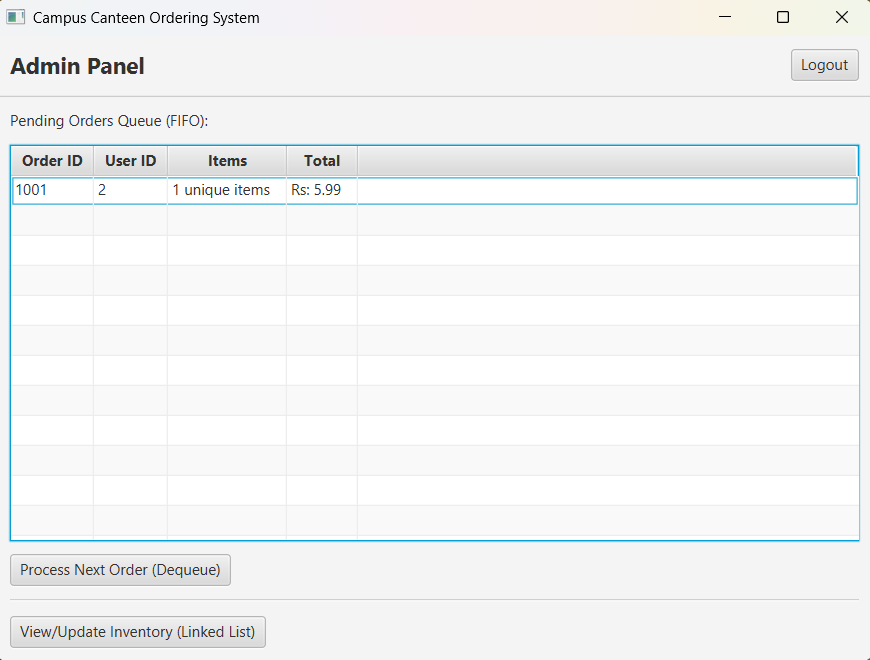
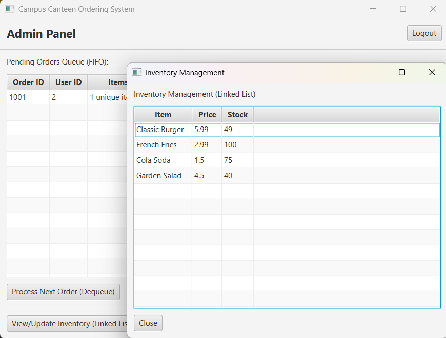
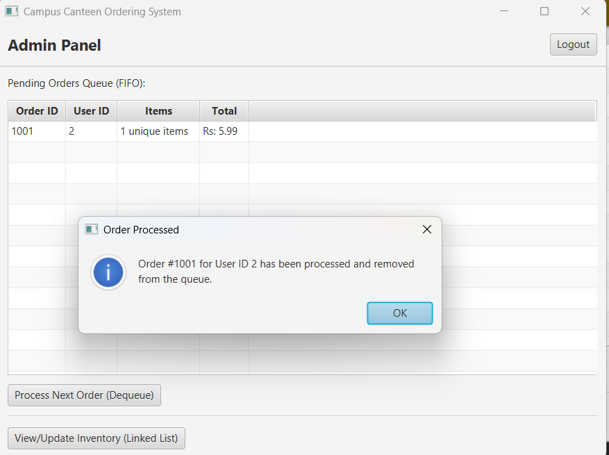
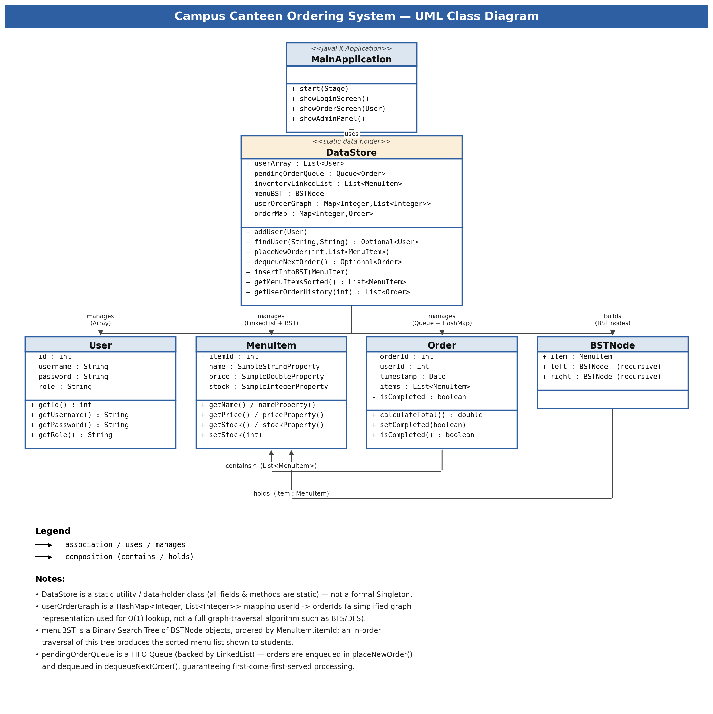

<div align="center">

# 🍔 Campus Canteen Ordering System

### A JavaFX Desktop Application Demonstrating Core Data Structures & Algorithms


*A DSA CCP (Complex Computing Problem) project — Faculty of Engineering Sciences and Technology, IQRA University*

</div>

---

## 📑 Table of Contents

- [Overview](#-overview)
- [Features](#-features)
- [Architecture](#️-architecture)
- [Data Structures Used](#-data-structures-used)
- [Screenshots](#-screenshots)
- [Tech Stack](#️-tech-stack)
- [Project Structure](#-project-structure)
- [Getting Started](#-getting-started)
- [Test Credentials](#-test-credentials)
- [UML Class Diagram](#-uml-class-diagram)
- [Roadmap](#-roadmap)
- [Author](#-author)
- [License](#-license)

---

## 📖 Overview

Manual canteen ordering breaks down during rush hours — long physical queues, lost paper order-slips, and no visibility into order status for either students or staff. **Campus Canteen Ordering System** replaces that process with a lightweight JavaFX desktop app where:

- Students browse a live, sorted menu and place orders digitally
- Orders are processed strictly **first-come-first-served (FIFO)**
- Inventory updates automatically the moment an order is placed
- Every student can pull up their own order history on demand

The project's primary goal is academic: each feature is deliberately implemented on top of a specific classical data structure, to demonstrate practical, real-world use cases for material covered in a DSA course.

---

## ✨ Features

- 🔐 Role-based authentication (Student / Admin)
- 📋 Live menu, always displayed sorted by item ID (via BST in-order traversal)
- 🛒 Shopping cart with running total
- ⏱️ FIFO order queue — fair, tamper-proof processing order
- 📦 Real-time inventory sync on every order
- 🧾 Per-user order history & invoice lookup
- 🛠️ Admin dashboard for queue processing and stock management

---

## 🏗️ Architecture

```
┌────────────────────┐        ┌──────────────────────┐        ┌───────────────────────────┐
│  MainApplication    │  uses  │      DataStore        │ manages│      Model Classes         │
│  (JavaFX UI layer)   │───────▶│ (static data-holder)  │───────▶│ User · MenuItem · Order ·  │
│  Login / Student /   │        │  owns every structure │        │        BSTNode             │
│  Admin views         │        │  below                │        │                             │
└────────────────────┘        └──────────────────────┘        └───────────────────────────┘
```

`DataStore` is intentionally a **static utility class** (not a Singleton — there's no `getInstance()`) that centralizes all in-memory state and business logic, keeping the UI layer free of data-manipulation code.

---

## 🧠 Data Structures Used

| # | Feature | Data Structure | Implementation Detail |
|---|---|---|---|
| 1 | User login | `ArrayList<User>` | Linear search via `findUser(username, password)` |
| 2 | Order processing | `Queue<Order>` (LinkedList-backed) | `.offer()` to enqueue, `.poll()` to dequeue — guarantees FIFO |
| 3 | Inventory | `LinkedList<MenuItem>` | Sequential storage, updated via `setStock()` on every order |
| 4 | Menu display | Binary Search Tree (`BSTNode`) | `insertIntoBST()` builds the tree by `itemId`; in-order traversal returns it pre-sorted |
| 5 | Order history | `HashMap<Integer, List<Integer>>` + `HashMap<Integer, Order>` | O(1) average lookup: userId → order IDs → full `Order` objects |

> **Design note:** the order-history map (`userOrderGraph`) is conceptually named a "graph" — it models a user-to-orders relationship — but its implementation is a direct `HashMap` lookup, not a traversal-based graph algorithm (BFS/DFS). See [Roadmap](#-roadmap).

---

## 🖼️ Screenshots

| Login | Student Panel |
|---|---|
|  |  |

| Order Placed (Enqueue) | Order History (HashMap lookup) |
|---|---|
|  |  |

| Admin Panel (FIFO Queue) | Inventory Management |
|---|---|
|  |  |

| Order Processed (Dequeue) |
|---|
|  |

---

## 🛠️ Tech Stack

| Layer | Technology |
|---|---|
| Language | Java 21 |
| UI Framework | JavaFX 21.0.2 |
| Build Tool | Maven |
| IDE | IntelliJ IDEA |

---

## 📂 Project Structure

```
canteen-maven/
├── pom.xml
└── src/main/java/
    ├── module-info.java
    ├── canteen/
    │   ├── MainApplication.java   # JavaFX UI — login, student panel, admin panel
    │   ├── User.java              # id, username, password, role
    │   ├── MenuItem.java          # itemId, name, price, stock (JavaFX Properties)
    │   └── Order.java             # orderId, userId, timestamp, items, isCompleted
    └── util/
        └── DataStore.java         # all data structures + core business logic
```

---

## 🚀 Getting Started

### Prerequisites
- JDK 21+
- Maven 3.8+
- Internet access (first run only, to fetch JavaFX dependencies)

### Run locally

```bash
git clone <your-repo-url>
cd canteen-maven
mvn clean javafx:run
```

Alternatively, open the project in **IntelliJ IDEA**, let Maven sync, then run `MainApplication.java` directly.

---

## 🔑 Test Credentials

| Role | Username | Password |
|---|---|---|
| Admin | `mahendardev` | `admin1` |
| Student | `abdulrafay` | `student1` |
| Student | `farzainali` | `student2` |

---

## 📐 UML Class Diagram

<div align="center">

</div>

---

## 📚 Documentation

- 📄 [Full Project Report](docs/DSA_Project_Report_Final.docx) — academic write-up, CCP mapping, test cases
- 🎞️ [Presentation Slides](docs/DSA_Presentation.pptx) — project walkthrough deck

---

## 📌 Roadmap

- [ ] Persist state to a real database (MySQL/SQLite) — currently fully in-memory
- [ ] Replace the `userOrderGraph` HashMap with a true adjacency-list graph + BFS/DFS traversal
- [ ] Payment gateway integration
- [ ] Push notifications when an order is ready for pickup
- [ ] Unit test coverage (JUnit) for `DataStore` operations

---

## 👤 Author

| Name | Registration ID |
|---|---|
| Mahendar Dev | 71355 |

Faculty of Engineering Sciences and Technology — IQRA University

---

## 📄 License

Built for academic purposes as part of a university CCP (Complex Computing Problem) assignment. Free to reference for learning purposes.
