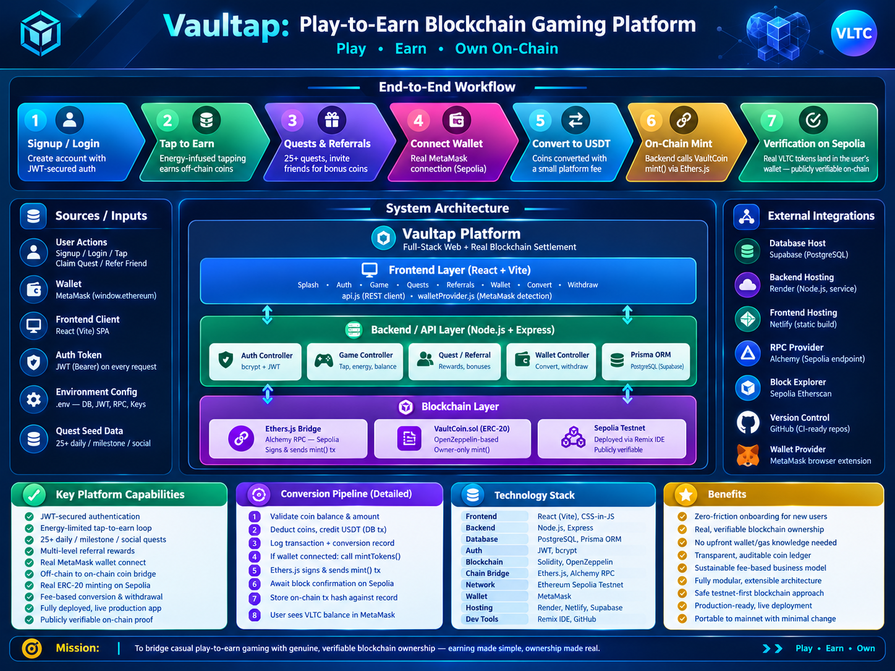
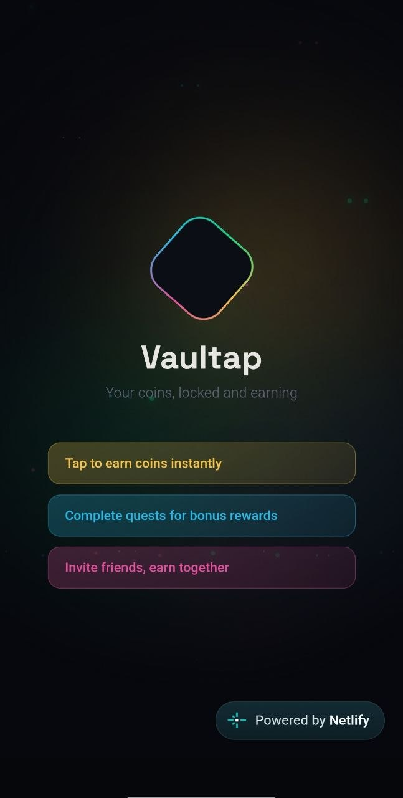
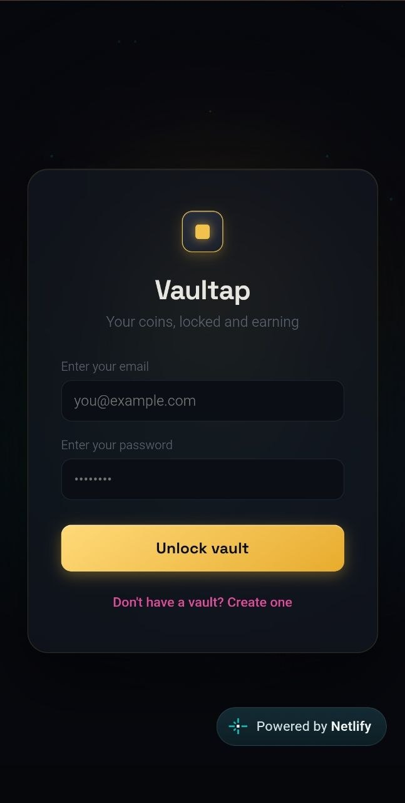
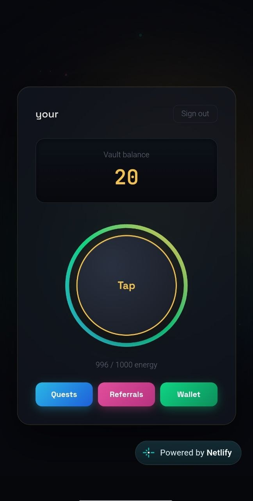
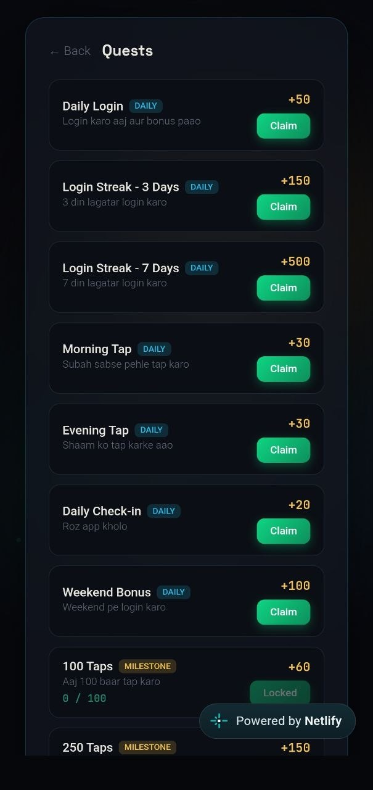
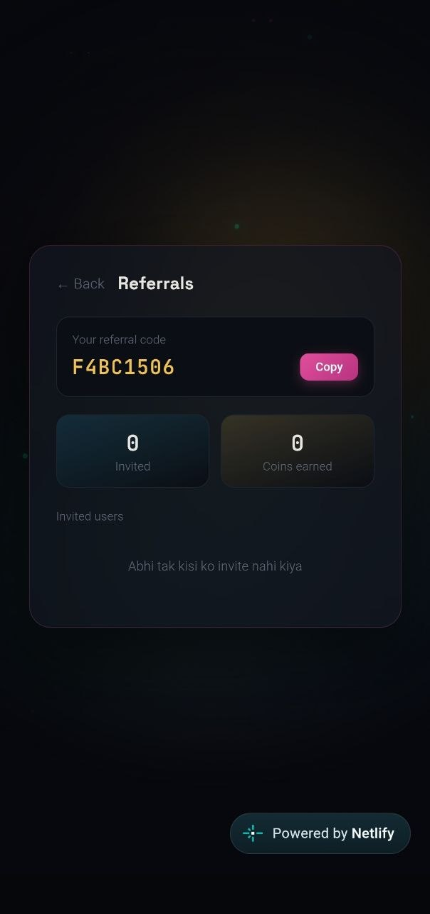
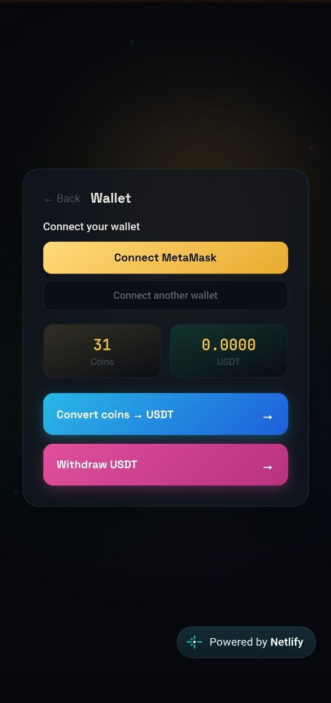
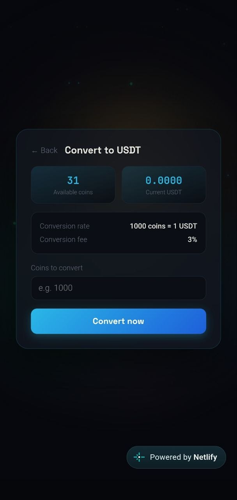
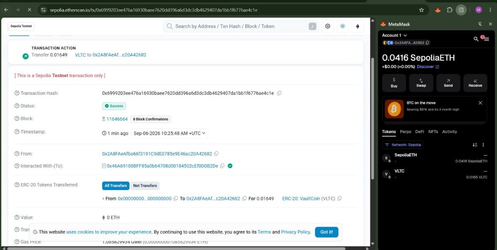

# 🔐 Vaultap: Play-to-Earn Blockchain Gaming Platform

[](https://nodejs.org/)
[](https://react.dev/)
[](https://ethereum.org/)
[](https://soliditylang.org/)
[](https://www.postgresql.org/)

🔴 **LIVE PREVIEW:** [Vaultap App (Deployed on Netlify + Render)](https://snazzy-brigadeiros-601eaf.netlify.app)

<p align="center">
  
</p>

**Vaultap** is a full-stack Play-to-Earn gaming platform that solves a **Real-World Problem**: letting everyday users earn spendable, blockchain-backed value from casual gameplay, without needing to understand wallets, gas fees, or smart contracts up front.

This repository contains the complete source code and documentation for Vaultap — a Complex Computing Problem (CCP) style project combining full-stack web development with real blockchain integration.

---

## 🌍 The Real-World Problem Solved

Most "earn coins by playing" apps are either pure marketing gimmicks (coins that can never leave the app) or overly complex crypto products that alienate non-technical users with wallets and seed phrases from the very first screen.

- **The Challenge:** Off-chain point systems have no real value and no way to prove a user's balance is genuine or tamper-free. On-chain-only systems demand crypto literacy before a user has even tried the product.
- **The Vaultap Solution:** Users start earning instantly with zero setup (tap-to-earn, quests, referrals, all off-chain). Only when they choose to convert their coins to USDT does the system mint real, verifiable **VaultCoin (VLTC)** ERC-20 tokens to their connected wallet on-chain — giving them a genuine bridge from casual play to real blockchain ownership, on their own terms.

---

## 🚀 Architecture Overview

The system is a **three-tier architecture** with a real blockchain settlement layer:

1. **Frontend (UI):** A dark, animated **React (Vite)** single-page app — splash screen, auth flow, tap-to-earn game, quests, referrals, and wallet screens.
2. **Backend / API:** A **Node.js + Express** REST API handling authentication (JWT), game logic, quests, referrals, and wallet operations.
3. **Database:** **PostgreSQL** (hosted on Supabase) via **Prisma ORM** — stores users, coin balances, transactions, quests, referrals, and conversion/withdrawal records.
4. **Smart Contract:** `VaultCoin.sol`, an **ERC-20 token contract** (OpenZeppelin-based) deployed on the **Ethereum Sepolia testnet**, with an owner-only `mint()` function.
5. **Blockchain Integration:** The backend uses **Ethers.js** to connect to Sepolia via an Alchemy RPC endpoint and mints real VaultCoin tokens to a user's MetaMask wallet whenever they convert in-app coins to USDT.
6. **Wallet Connectivity:** Real **MetaMask** integration (`window.ethereum`) for wallet connection and on-chain balance verification.

---

## 📁 Repository Structure

```
📦 Vaultap
 ┣ 📂 Backend                  # Node.js + Express API
 ┃ ┣ 📂 src
 ┃ ┃ ┣ 📂 controllers          # auth, game, quest, referral, wallet logic
 ┃ ┃ ┣ 📂 routes                # Express route definitions
 ┃ ┃ ┣ 📂 middleware            # JWT auth middleware
 ┃ ┃ ┣ 📂 blockchain            # vaultCoin.js - Ethers.js contract integration
 ┃ ┃ ┗ 📜 server.js             # Express app entry point
 ┃ ┣ 📂 prisma
 ┃ ┃ ┣ 📜 schema.prisma         # Database models
 ┃ ┃ ┗ 📜 seed.js               # Seeds 25+ quests
 ┃ ┗ 📜 package.json
 ┣ 📂 Frontend                 # React (Vite) client
 ┃ ┣ 📂 src
 ┃ ┃ ┣ 📂 components            # Splash, Auth, Game, Quests, Referrals, Wallet, Convert, Withdraw
 ┃ ┃ ┣ 📜 api.js                # Backend API client
 ┃ ┃ ┗ 📜 walletProvider.js     # MetaMask-specific wallet detection
 ┃ ┗ 📜 package.json
 ┣ 📂 Doc                      # Project documentation
 ┣ 📂 Screenshots              # App screenshots
 ┗ 📜 README.md
```

---

## 🛡️ CCP Requirements Checklist

- [x] **Frontend:** React (Vite) SPA with 8+ screens, animated UI, MetaMask integration.
- [x] **Backend:** Node.js + Express REST API, JWT authentication, modular controllers.
- [x] **API Integration:** Frontend consumes backend REST APIs for all game/wallet/social features.
- [x] **Database:** PostgreSQL via Prisma ORM, 9+ relational models, hosted on Supabase.
- [x] **Blockchain Code:** ERC-20 smart contract (`VaultCoin.sol`) written in Solidity, deployed on Ethereum Sepolia testnet, with backend-driven on-chain minting via Ethers.js — verifiable on [Sepolia Etherscan](https://sepolia.etherscan.io/address/0x46A69108BFF85a0b64708d00184502cEf0D0B2De).
- [x] **Authentication:** bcrypt password hashing, JWT session tokens.
- [x] **Play-to-Earn Mechanics:** Tap-to-earn, energy system, 25+ daily/milestone/social quests.
- [x] **Referral System:** Multi-level referral bonuses with live tracking.
- [x] **Wallet Integration:** Real MetaMask connect, on-chain token minting, coin-to-USDT conversion.
- [x] **Deployment:** Backend live on Render, frontend live on Netlify, database live on Supabase.

---

## 🛠️ Deployment Instructions (For a Fresh Clone)

### Prerequisites

1. **Node.js:** v18 or higher installed (`node -v` to check).
2. **npm:** Comes bundled with Node.js.
3. A **PostgreSQL** database (e.g. a free [Supabase](https://supabase.com) project).
4. A **MetaMask** wallet with Sepolia testnet ETH (from a [Sepolia faucet](https://sepoliafaucet.com)).
5. An **Alchemy** (or Infura) account for a Sepolia RPC URL.

### Step 1: Clone and Install

```
git clone https://github.com/Mahendar-Dev/Vaultap.git
cd Vaultap
```

### Step 2: Backend Setup

```
cd Backend
npm install
cp .env.example .env
```

Fill in `.env` with:
```
DATABASE_URL="your-supabase-postgres-connection-string"
JWT_SECRET="your-random-secret"
ALCHEMY_RPC_URL="your-alchemy-sepolia-url"
DEPLOYER_PRIVATE_KEY="your-wallet-private-key"
VAULT_COIN_CONTRACT_ADDRESS="0x46A69108BFF85a0b64708d00184502cEf0D0B2De"
```

```
npx prisma migrate dev
node prisma/seed.js
npm run dev
```

### Step 3: Frontend Setup

```
cd ../Frontend
npm install
npm run dev
```

The frontend runs at `http://localhost:5173` and connects to the backend at `http://localhost:5000`.

---

## 🎮 App Flow

1. **Splash screen** → animated intro with feature highlights.
2. **Signup/Login** → username, email, password, optional referral code.
3. **Tap-to-earn** → energy-limited tapping earns off-chain coins.
4. **Quests** → 25+ daily, milestone, and social quests for bonus coins.
5. **Referrals** → invite friends, earn a share of their signup bonus.
6. **Wallet** → connect MetaMask, convert coins to USDT (mints real VaultCoin on Sepolia), withdraw USDT.

---

## 📸 Screenshots

<p align="center">
  
  
  
  
</p>
<p align="center">
  
  
  
  
</p>

---

*Developed as a full-stack Complex Computing Problem (CCP) solution combining web development with real blockchain integration.*
