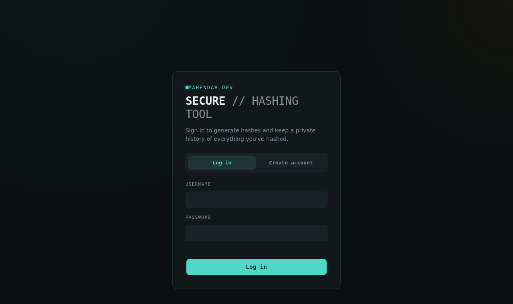
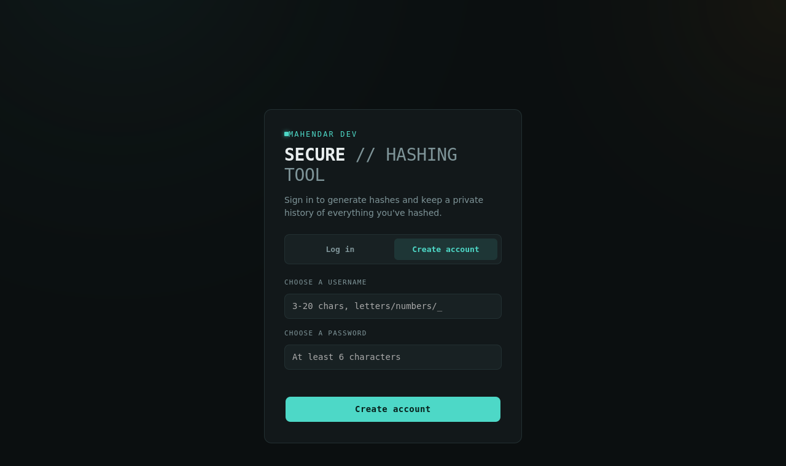
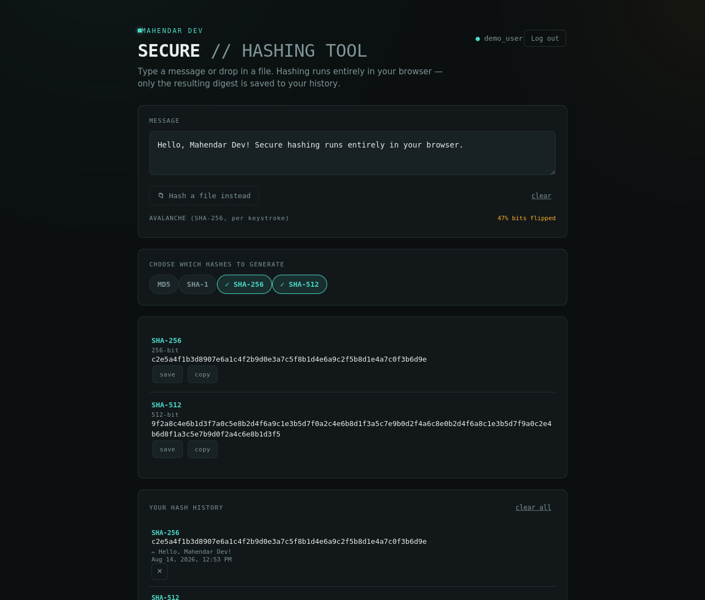

<div align="center">

# 🛡️ Mahendar Dev — Secure Hashing Tool

### A full-stack cryptographic digest platform with accounts, live avalanche visualization, and persistent hash history.

[](https://nodejs.org)
[](https://expressjs.com)
[](https://nodejs.org/api/sqlite.html)
[](https://jwt.io)
[](#-license)

</div>

---

## 🌍 The Problem It Solves

Online hash generators (the free browser-tab kind) throw your result away the moment you close the tab. There's no record of what you hashed, when, or with which algorithm — which matters for developers verifying file integrity, students learning cryptographic primitives, or anyone auditing checksums over time.

**Mahendar Dev — Secure Hashing Tool** solves this by pairing a zero-latency, client-side hashing engine with a lightweight authenticated backend that remembers every digest you choose to save — complete with algorithm, source, and exact timestamp.

---

## ✨ Features

- 🔐 **Real accounts** — bcrypt-hashed passwords, JWT-based sessions
- 🧮 **5 hash algorithms** — MD5, SHA-1, SHA-256, SHA-384, SHA-512, computed live as you type
- 📁 **Text or file input** — hash a pasted message or drag in any file
- 🎯 **Pick exactly what you need** — toggle chips to show only the algorithms you care about
- 🌊 **Avalanche visualizer** — a live bit-grid that shows how violently the SHA-256 digest changes with every keystroke (the defining property of a good hash function)
- 🕒 **Persistent history** — every saved hash is stored with algorithm, source label, and exact date/timestamp
- 🗑️ **Full history control** — delete individual entries or wipe everything in one click
- 🎨 **Distinctive dark UI** — monospace-driven "lab" aesthetic, not a generic Bootstrap form
- 🔒 **Privacy by design** — your message/file is *never* transmitted to the server; only the final digest is saved, and only when you explicitly hit "save"
- ⚡ **Zero native dependencies** — runs on Node's built-in SQLite module, so `npm install` never needs a C++ compiler or Visual Studio Build Tools

---

## 📸 Screenshots

<table>
<tr>
<td width="50%">

**Login**


</td>
<td width="50%">

**Create account**


</td>
</tr>
</table>

**Hashing tool + live history**


---

## 🏗️ Architecture Overview

```
┌─────────────────────┐         ┌──────────────────────┐         ┌────────────────────┐
│   Browser (Client)   │  HTTPS  │   Express API Server  │  SQL    │   SQLite Database   │
│                      │ ──────► │                       │ ──────► │                     │
│ • Web Crypto API     │         │ • JWT auth middleware │         │ • users             │
│ • Local MD5 engine   │  JSON   │ • bcrypt password hash│         │ • hash_history      │
│ • Hashing happens    │ ◄────── │ • REST endpoints      │ ◄────── │ (node:sqlite,       │
│   entirely in-browser│         │                       │         │  no native build)   │
└─────────────────────┘         └──────────────────────┘         └────────────────────┘
```

**Why this design?** Hashing is cheap and instant client-side — there's no reason to round-trip your raw message to a server just to compute a digest. The backend's only job is identity (accounts) and memory (history), which is exactly what a server should be trusted with and a browser shouldn't have to manage alone.

---

## 📁 Repository Structure

```
📦 mahendar-hash-tool
 ┣ 📂 server                      # Node.js + Express backend
 ┃ ┣ 📜 server.js                 # App entry point, static file serving
 ┃ ┣ 📜 db.js                     # SQLite schema (node:sqlite, zero native deps)
 ┃ ┣ 📂 middleware
 ┃ ┃ ┗ 📜 auth.js                 # JWT verification middleware
 ┃ ┣ 📂 routes
 ┃ ┃ ┣ 📜 auth.js                 # /api/auth/register, /api/auth/login
 ┃ ┃ ┗ 📜 history.js              # /api/history — CRUD, JWT-protected
 ┃ ┗ 📜 package.json
 ┣ 📂 public                      # Frontend (no build step required)
 ┃ ┣ 📜 index.html                # Auth screen + hashing tool markup
 ┃ ┣ 📜 styles.css                # Dark "lab" theme, IBM Plex typography
 ┃ ┣ 📜 hash-engine.js            # MD5 implementation + Web Crypto wrapper
 ┃ ┗ 📜 app.js                    # Auth flow, hashing UI, history sync
 ┗ 📜 README.md
```

---

## 🧰 Tech Stack

| Layer            | Technology                                      | Why                                                          |
|-------------------|--------------------------------------------------|----------------------------------------------------------------|
| Frontend           | Vanilla HTML/CSS/JS, Web Crypto API              | No build step, no framework overhead, instant hashing          |
| Backend            | Node.js + Express                                | Minimal, battle-tested REST API layer                          |
| Database           | `node:sqlite` (Node's built-in SQLite)           | Zero native compilation — installs cleanly on every OS          |
| Authentication     | JWT (`jsonwebtoken`) + `bcryptjs`                | Stateless sessions, industry-standard password hashing          |
| Legacy hash support| Custom in-browser MD5 implementation             | `MD5` isn't in Web Crypto API, so it's implemented from scratch |

---

## ✅ Capability Checklist

- [x] User registration & login (bcrypt + JWT)
- [x] Client-side hashing — MD5 / SHA-1 / SHA-256 / SHA-384 / SHA-512
- [x] File hashing (not just text)
- [x] Selectable algorithm chips
- [x] Live avalanche-effect visualization
- [x] Persistent, per-user hash history with timestamps
- [x] Delete single entry / clear all history
- [x] Zero-native-dependency install (Windows-friendly, no Visual Studio required)
- [x] Fully responsive, distinctive dark UI

---

## 🚀 Getting Started

### Prerequisites

- **Node.js v22.5 or newer** (required for the built-in `node:sqlite` module — check with `node -v`)

### Installation

```bash
# 1. Move into the server directory
cd mahendar-hash-tool/server

# 2. Install dependencies (pure JS — no compiler needed)
npm install

# 3. Start the server
npm start
```

You should see:

```
Mahendar Dev — Secure Hashing Tool running at http://localhost:3000
```

Open **http://localhost:3000**, create an account, and start hashing.

### Optional configuration

Create a `.env` file inside `server/` to override defaults:

```env
PORT=3000
JWT_SECRET=replace-this-with-a-long-random-string
```

> ⚠️ `JWT_SECRET` has a fallback value for local testing only — always set your own random secret before deploying anywhere public.

---

## 📡 API Reference

| Method | Route               | Auth required | Description                          |
|--------|---------------------|:--------------:|----------------------------------------|
| `POST` | `/api/auth/register`| ❌             | Create an account → returns a JWT      |
| `POST` | `/api/auth/login`   | ❌             | Log in → returns a JWT                 |
| `POST` | `/api/history`      | ✅             | Save a hash entry                      |
| `GET`  | `/api/history`      | ✅             | List your saved hashes (newest first)  |
| `DELETE`| `/api/history/:id` | ✅             | Delete one entry                       |
| `DELETE`| `/api/history`     | ✅             | Clear all your history                 |

Protected routes require:
```
Authorization: Bearer <token>
```

---

## ☁️ Deployment

This is a standard Node.js app — deploy it anywhere that runs Node (Render, Railway, Fly.io, a VPS, etc.).

1. Set a strong, unique `JWT_SECRET` environment variable on your host.
2. SQLite writes to a local file (`server/data.sqlite`) — make sure your host provides a **persistent disk/volume**. Serverless/ephemeral-filesystem platforms will lose data on redeploy; use a hosted database there instead.
3. Set `PORT` if your host requires a specific port binding.

---

## 🔒 Security Notes

- Passwords are hashed with **bcrypt** (never stored in plaintext)
- Sessions use **signed JWTs** with a 7-day expiry
- The message/file you hash is **never sent to the server** — only the resulting digest, algorithm, and a short label are persisted, and only on explicit save
- MD5 and SHA-1 are included for compatibility/legacy use cases and are labeled `legacy` in the UI — **SHA-256 or stronger is recommended** for any security-sensitive use

---

<div align="center">

*Built by Mahendar Dev*

</div>
