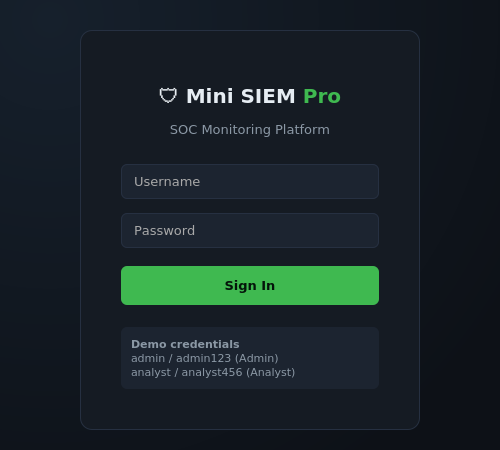
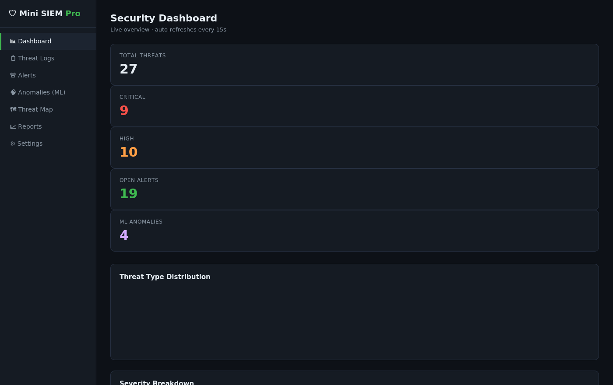
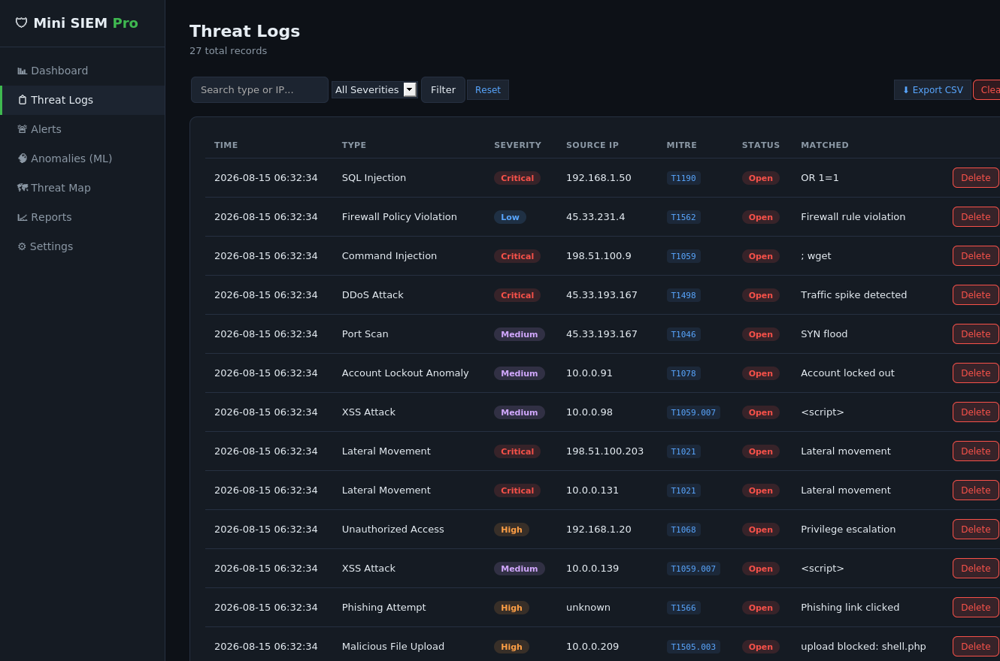
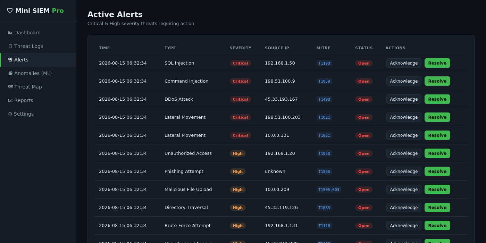
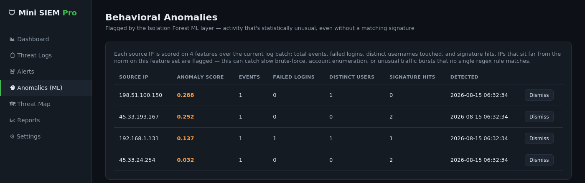
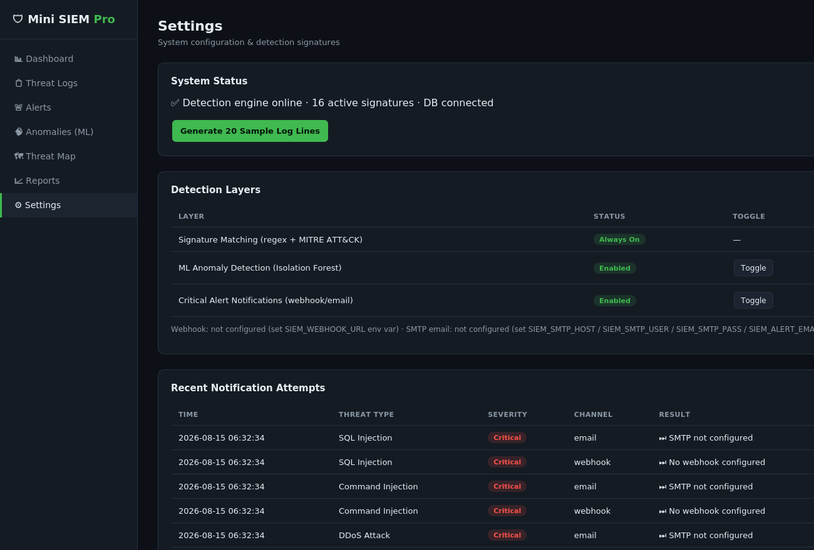

# 🛡️ Mini SIEM Pro

### A hybrid signature + machine-learning SOC monitoring platform with live dashboards, MITRE ATT&CK-mapped detections, and behavioral anomaly detection.

[](https://python.org)
[](https://flask.palletsprojects.com)
[](https://sqlite.org)
[](https://scikit-learn.org)
[](#-license)

---

## 🌍 The Problem It Solves

Real SOC platforms — Splunk Enterprise Security, Microsoft Sentinel, Elastic Security — are powerful but come with licensing cost, heavy infrastructure, and a steep learning curve that makes them impractical for hands-on learning. Free open-source alternatives like Wazuh exist, but they're themselves complex multi-service deployments that bury the actual detection logic under operational overhead.

**Mini SIEM Pro** solves this by implementing a complete, self-contained SOC workflow — log ingestion, dual-layer threat detection, alert triage, geographic visualization, and reporting — in a codebase small enough to fully read, understand, and extend in an afternoon, while still following the same detection philosophy (signatures + behavioral analytics, MITRE ATT&CK-tagged) used in production tooling.

---

## ✨ Features

- 🎯 **16 signature-based detections** — regex rules covering SQLi, XSS, brute force, lateral movement, C2 beaconing, and more, each tagged with a **MITRE ATT&CK technique ID**
- 🧠 **ML anomaly detection** — an Isolation Forest scores every source IP on event volume, failed logins, distinct users touched, and signature hits, flagging statistically unusual behavior that no regex rule matches
- 🗺️ **Geographic threat map** — Leaflet.js world map with severity-colored markers per source IP
- 🚨 **Alert triage workflow** — Acknowledge/Resolve actions, SLA reference table, live auto-refreshing dashboard
- 📡 **Outbound notifications** — optional Slack/Teams/Discord webhook and SMTP email dispatch on Critical threats
- 📊 **Live dashboard** — Chart.js bar/doughnut charts, auto-refresh every 15s, zero page reloads
- 📁 **Reporting** — one-click CSV export and a formatted PDF report (ReportLab)
- 🔐 **Role-based access control** — bcrypt-hashed passwords; only Admins can wipe the database
- 🧾 **Full audit trail** — every login, acknowledge, resolve, delete, and export is logged
- ⚡ **Zero external services required** — SQLite file database, no Docker, no separate DB server

---

## 📸 Screenshots

| **Login** | **Live Dashboard** |
|---|---|
|  |  |

| **Threat Logs** | **Active Alerts** |
|---|---|
|  |  |

| **ML Anomalies** | **Settings** |
|---|---|
|  |  |

---

## 🏗️ Architecture Overview

```
┌────────────────────┐        ┌───────────────────────────┐        ┌──────────────────────┐
│   Log Source        │        │   Detection Layer (dual)   │        │   Persistence Layer    │
│                     │        │                             │        │                       │
│ • auth.log          │ ─────► │ • Signature Engine          │ ─────► │ • SQLite (SQLAlchemy) │
│   (generator.py     │  read  │   (regex + MITRE ATT&CK)    │  write │ • Threat / Anomaly /  │
│   simulates traffic)│        │ • ML Engine                 │        │   User / AuditLog /   │
│                     │        │   (Isolation Forest)        │        │   Notification tables │
└────────────────────┘        └───────────────────────────┘        └──────────────────────┘
                                          │                                      │
                                          │ Critical threat                     │ query
                                          ▼                                      ▼
                               ┌───────────────────┐              ┌──────────────────────────┐
                               │  Notifier           │              │  Flask Web App (Jinja2)   │
                               │  (webhook / email)   │              │  Dashboard · Logs · Alerts │
                               └───────────────────┘              │  Anomalies · Threat Map ·  │
                                                                    │  Reports · Settings        │
                                                                    └──────────────────────────┘
```

**Why two detection layers?** Signature matching is precise and explainable but can only catch attack patterns someone already wrote a rule for. The Isolation Forest layer catches the complement — activity that's statistically abnormal (e.g. an IP hammering several usernames with failed logins) even when no single line matches a known signature. Keeping them as independently toggleable layers (see Settings) makes it easy to see exactly what each one contributes.

---

## 📁 Repository Structure

```
📦 MiniSIEM-Pro
 ┣ 📜 app.py                  # Flask app — routes, models, auth, JSON API
 ┣ 📜 detector.py              # 16 regex signatures mapped to MITRE ATT&CK
 ┣ 📜 ml_detector.py            # Isolation Forest behavioral anomaly detection
 ┣ 📜 geoip.py                  # Source IP geolocation (offline sim + live API path)
 ┣ 📜 notifier.py               # Webhook / email alert dispatch
 ┣ 📜 generator.py              # Simulated log generator (benign + attack traffic)
 ┣ 📜 requirements.txt
 ┣ 📂 templates                 # Jinja2 templates (dashboard, logs, alerts, etc.)
 ┣ 📂 static/css                # Dark SOC theme
 ┣ 📂 logs                      # auth.log — simulated log source (auto-created)
 ┗ 📂 instance                  # siem.db — SQLite database (auto-created)
```

---

## 🧰 Tech Stack

| Layer | Technology | Why |
|---|---|---|
| Backend | Python 3.10+, Flask 3.x | Lightweight, minimal boilerplate, easy to read end-to-end |
| Database / ORM | SQLite + Flask-SQLAlchemy | Zero-configuration, file-based — no separate DB server |
| Authentication | bcrypt + Flask sessions | Adaptive, salted password hashing — industry standard |
| ML | scikit-learn (`IsolationForest`), NumPy | Explainable unsupervised anomaly detection, no labeled data needed |
| Reporting | ReportLab | Programmatic PDF generation |
| Frontend | Jinja2, vanilla JS, Chart.js, Leaflet.js | No build step, no framework overhead |

---

## ✅ Capability Checklist

- [x] Signature-based detection — 16 rules, MITRE ATT&CK-mapped
- [x] ML-based behavioral anomaly detection (Isolation Forest)
- [x] Geographic threat map (Leaflet.js)
- [x] Role-based access control (Admin / Analyst)
- [x] bcrypt password hashing
- [x] Alert acknowledge / resolve workflow
- [x] Outbound webhook + email notifications on Critical alerts
- [x] CSV export + PDF report generation
- [x] Full audit log of analyst actions
- [x] Live auto-refreshing dashboard (no page reloads)
- [x] Zero-external-service install (single SQLite file, no Docker)

---

## 🚀 Getting Started

### Prerequisites

- **Python 3.10 or newer** — check with `python --version`
- **pip** (comes with Python)

### Installation

```bash
# 1. Move into the project directory
cd MiniSIEM-Pro

# 2. Install dependencies
pip install -r requirements.txt

# 3. Start the server
python app.py
```

You should see:

```
* Running on http://127.0.0.1:5000
```

Open **http://127.0.0.1:5000**, log in, and start exploring.

### Demo credentials

| Username | Password | Role |
|---|---|---|
| `admin` | `admin123` | Admin |
| `analyst` | `analyst456` | Analyst |

### Generate sample traffic

From **Settings**, click **"Generate 20 Sample Log Lines"** (click it 2–3 times so the ML layer has enough distinct source IPs to train on — it needs at least 6). Or, for a continuous live feed, run in a second terminal:

```bash
python generator.py
```

### Optional configuration

Set these environment variables to enable outbound alerting (both are off by default — the app runs fine without them):

```bash
export SIEM_WEBHOOK_URL="https://hooks.slack.com/services/..."
export SIEM_SMTP_HOST="smtp.gmail.com"
export SIEM_SMTP_PORT="587"
export SIEM_SMTP_USER="you@example.com"
export SIEM_SMTP_PASS="app-specific-password"
export SIEM_ALERT_EMAIL_TO="soc-team@example.com"
```

> ⚠️ On a machine with internet access, set `LIVE_LOOKUP = True` at the top of `geoip.py` to switch the threat map from its offline simulation table to real `ip-api.com` lookups.

---

## 📡 API Reference

| Method | Route | Auth required | Description |
|---|---|---|---|
| `GET` | `/api/stats` | ✅ | Live threat/anomaly counts for the dashboard |
| `GET` | `/api/recent_threats` | ✅ | Last 10 detected threats |
| `GET` | `/api/threat_distribution` | ✅ | Threat counts grouped by type |
| `GET` | `/api/severity_breakdown` | ✅ | Threat counts grouped by severity |
| `GET` | `/threats/export_csv` | ✅ | Download full threat log as CSV |
| `GET` | `/download_report` | ✅ | Download a formatted PDF report |
| `POST` | `/settings/generate_samples` | ✅ | Generate 20 simulated log lines |
| `POST` | `/settings/toggle_ml` | ✅ | Enable/disable the ML anomaly layer |
| `POST` | `/settings/toggle_notifications` | ✅ | Enable/disable outbound alerting |

All routes require an active session (log in via `/login`).

---

## 🔒 Security Notes

- Passwords are hashed with **bcrypt** — never stored or compared in plaintext
- Sessions use Flask's **signed cookies** with an 8-hour expiry
- Destructive actions (full database wipe) are gated by an `admin_required` decorator at the **route level**, not just hidden in the UI
- Every state-changing action (login, delete, export, DB wipe) is written to an immutable audit log
- The GeoIP threat map's offline mode is clearly labeled as simulated data — it is not represented as real attacker geolocation

---

## 🎓 Academic Use

This project was built as a Final Year Project (FYP) demonstrating a hybrid signature + ML detection architecture at a scale suitable for a single student to fully implement, test, and defend. See `MiniSIEM_Pro_FYP_Report.docx` for the full report — including literature review, system design, MITRE ATT&CK signature table, evaluation methodology, and results.

---

## 🛣️ Future Work

- Swap the flat-file log source for a live syslog/journald tail
- Replace the offline GeoIP table with a MaxMind GeoLite2 database
- Train/evaluate the Isolation Forest against a labeled dataset (e.g. CICIDS2017) for formal precision/recall
- Add a rule-authoring UI so signatures can be added without editing source code

---

*Built for hands-on SOC / SIEM learning.*
